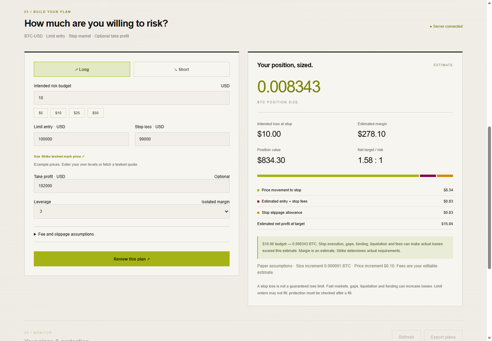

# StrikePlan

**Your risk. Your rules. Your trade.** A direct Strike trade planner: enter an intended dollar risk budget, entry and stop; review position size, costs, margin and target; confirm a paper plan or submit a native Strike testnet bracket order. No TradingView account, alert strategy, subscription or public webhook is required.



## Verified implementation

The testnet workflow has been exercised against Strike: authenticated Cardano account access, live BTC market rules, native bracket submission, filled entry, observed armed stop/target orders, and reconciliation after the user manually closed the position. The final account check confirmed zero BTC exposure and no open BTC orders. See [verification evidence](artifacts/strikeplan-testnet-verification.json).

The [recorded walkthrough](artifacts/strikeplan-paper-demo.webm) demonstrates paper scenarios; it does not depict the live exchange trade. Automated tests mock the exchange transport. Mainnet execution is disabled. Manual closure is recognized only after verifying the entry is terminal, the account is flat, and no BTC orders remain; failed lookups do not imply closure.

## Run

Requires Node.js 24 or newer. No dependency installation is needed.

```powershell
npm.cmd start
```

Open http://localhost:8787. A same-origin localhost browser authenticates automatically. For remote access, run `npm.cmd run token` locally and enter that token in the Connection section. Tokens and private keys must not be shared in chat or committed.

## Try it without a trading account

1. Start in paper mode. The calculator defaults to example BTC prices; these are not a live quote.
2. Enter direction, risk budget, limit-entry price, stop price, optional take profit and leverage.
3. Review fee-per-side and stop-slippage assumptions. They are editable estimates, not verified fee tiers.
4. Click **Review this plan**. The server independently calculates and saves a 60-second preview.
5. Read the order summary, acknowledge the estimate's limits and confirm the paper plan.
6. In the monitor, simulate a stop hit, target hit, or close at entry. Results come from the reviewed assumptions; they are not actual exchange fills.

Only one submitted/open/uncertain plan is allowed at a time. Close the paper scenario before creating a new position. Closed plans survive restart and can be exported as JSON.

## Calculation

For a linear USD-denominated BTC perpetual:

```text
loss per BTC = abs(entry − stop)
estimated fees per BTC = (entry + stop) × fee_bps / 10,000
stop slippage allowance per BTC = stop × slippage_bps / 10,000
raw BTC size = risk budget / (loss per BTC + fees per BTC + slippage allowance per BTC)
```

Quantity is rounded down to the lot increment. The prototype caps positions at the smaller of 0.1 BTC, $10,000 notional and the market maximum. Minimum quantity, minimum notional and price increments are validated. Approximate initial margin is notional / selected leverage. Target profit subtracts estimated entry/target fees. Funding is excluded.

**Intended risk is not a maximum-loss guarantee.** Gaps, stop slippage beyond the allowance, liquidation, funding and actual fee rates can increase losses. No liquidation price is calculated. An isolated-margin/leverage estimate does not establish that a stop will execute before liquidation. Limit entries may not fill; partial fills require protection checks.

## Strike testnet setup

1. Obtain confirmed Strike testnet access and test collateral from the official hackathon organizers. A verified testnet registration/faucet URL has not been established in this project.
2. Open the Connection section. **Generate API wallet locally** creates a reusable Ed25519 key pair stored under ignored `.data/`. Only the public key is displayed.
3. Register that public key in Strike's testnet environment using your own connected wallet. The docs link to https://app.strikefinance.org/api-keys, which may default to mainnet: confirm the environment before registering. No real-money deposit is needed for this prototype.
4. Return to the app, choose **Strike testnet** and save/verify. If you reloaded before saving, click Generate API wallet locally again to select the existing pending key. Existing API wallet keys may also be entered manually. Private keys are never returned by the API.
5. Use a dedicated, flat testnet account/subaccount with no resting BTC orders. Testnet preview retrieves current market rules; execution stops if rules cannot be verified.
6. Fetch a testnet mark price if desired, choose your own levels, then review and explicitly confirm the order. The mark-price button resets example stop/target distances; those are editable examples, not a recommended strategy.

On submission the server checks for existing BTC exposure and orders, revalidates size, checks stop direction against the mark, sets isolated margin and selected leverage, and submits a **limit** entry with a linked stop-market order and optional take-profit market order through `/v2/order/strategy`. The order is never retried automatically after an ambiguous response.

The monitor polls entry and protective orders by their client IDs. Entry acknowledgements do not mean filled. A stop is reported as confirmed only when its ID, symbol, side, trigger, size and live status match the filled exposure. Missing/rejected protection is flagged **unprotected**. Inspect and manage/cancel exchange orders directly in Strike; cancellation and emergency flattening are not implemented in this UI. Mainnet is disabled.

## Verification

```powershell
npm.cmd test
```

Tests cover risk geometry, conservative sizing, increments/minima, fees/slippage, auth, preview expiration, duplicate execution, one-plan limits, paper outcomes, bracket payloads, uncertain submissions and protection monitoring. Strike API calls in tests are mocked; this is not evidence of live exchange integration.

`scripts/check-3d.mjs` checks chart controls and mobile/reduced-motion behavior using a dedicated Edge DevTools instance on localhost:9223. `scripts/record-demo.mjs` records an isolated paper planner on localhost:8788 and produces `artifacts/strikeplan-paper-demo.webm`. Do not use it to claim live execution.

## Storage and hosting

`.data/` contains the SQLite database, dashboard token, saved connection and pending API-wallet secrets. Restrict local filesystem access and back up the directory. Do not delete it to clear an uncertain order. Use one application process per database. For remote hosting, use HTTPS and preserve forwarding/Host headers. The Dockerfile supports a persistent `/app/.data` volume; its container build has not been verified here.

The public Cloudflare tunnel previously used for SignalBridge is optional for sharing this UI. It is no longer needed for trading. The original TradingView webhook returns HTTP 410 by default. Legacy regression tests remain for migration, but the production workflow cannot execute old external alerts. Obsolete SignalBridge notes and artifacts are excluded from this repository.

## Primary references

- [Strike API wallet authentication](https://docs.strikefinance.org/api/getting-started)
- [Native bracket orders and order queries](https://docs.strikefinance.org/api/trade/orders)
- [Market increments and trading rules](https://docs.strikefinance.org/api/market/rest-api/exchange-info)
- [Leverage and margin configuration](https://docs.strikefinance.org/api/trade/trading)

Independent hackathon prototype; not an official Strike product.
